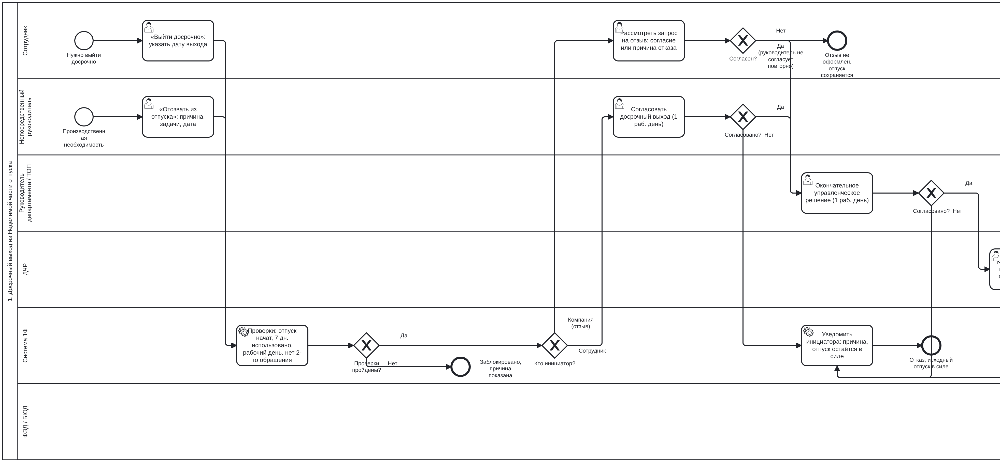
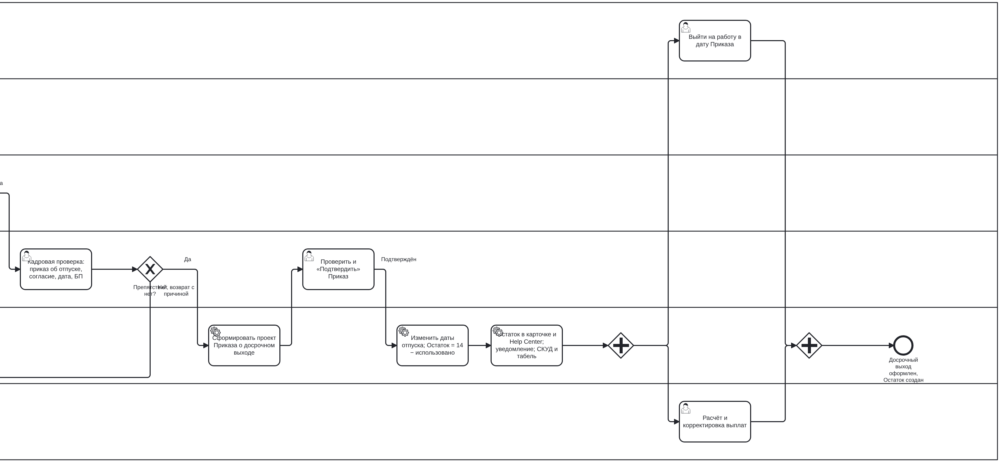
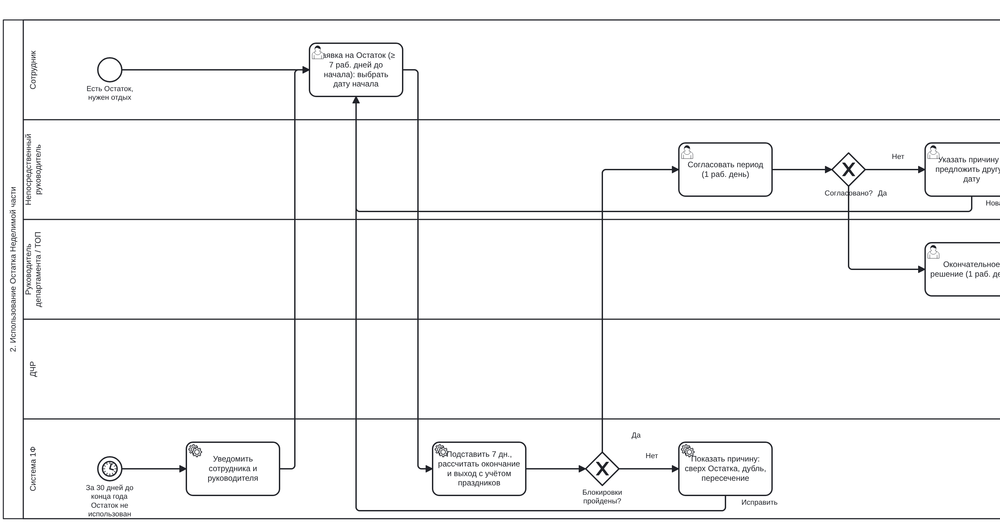
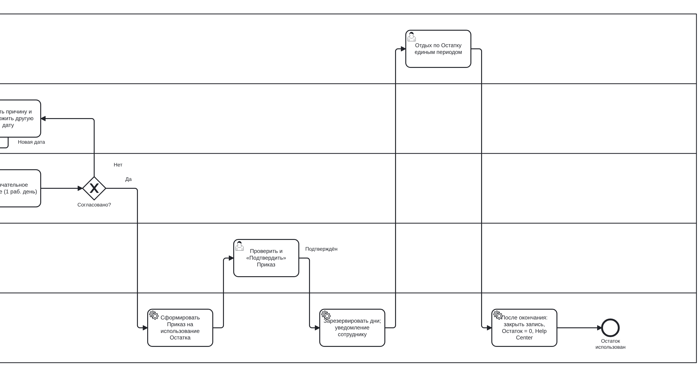

# Досрочный выход из Неделимой части отпуска: схема процесса и анализ автоматизации в 1Ф

Основание: Приказ ЗАО «КОИНОТИ НАВ» об утверждении Инструкции о порядке досрочного выхода
из Неделимой части ежегодного трудового отпуска и использования её неиспользованного остатка
(далее — Инструкция), Приложение №1 «Требования к автоматизации… (для ДИТ)».
Подготовил: Рон (Claude) для ДИТ, 25.11.2026. Версия 1.0.

## 1. Коротко
- Процесс состоит из двух связанных процессов: **досрочный выход** из Неделимой части (14 дней)
  и **использование Остатка** (7 дней), который появляется после досрочного выхода.
- Досрочный выход бывает двух видов: по просьбе сотрудника («Выйти досрочно») и по инициативе
  Компании («Отозвать из отпуска»). Порядок согласования у обоих один.
- В 1Ф уже есть раздел «HR → Заявка на предоставление отпуска и отгулов» (id 60). В нём нет
  ни действий досрочного выхода, ни Приказа, ни учёта Остатка. Автоматизация — это доработка
  этого раздела плюс новый связанный раздел для Приказа.
- Сложные места: производственный календарь (праздники), расчёт «рабочих дней», интеграция
  со СКУД и табелем, поле в Help Center.

## 2. Участники
| Участник | Роль в процессе |
|---|---|
| Сотрудник | Инициирует «Выйти досрочно», даёт согласие на отзыв, подаёт заявку на Остаток |
| Непосредственный руководитель | Инициирует отзыв, согласует обращение (1 рабочий день) |
| Руководитель департамента / вышестоящий ТОП | Окончательное управленческое решение (1 рабочий день) |
| ДЧР | Кадровая проверка, подтверждение Приказа, служебная корректировка |
| Система 1Ф | Проверки, расчёты, Приказ, уведомления, Help Center, СКУД и табель |
| ФЭД / БЮД | Расчёт и корректировка выплат по подтверждённому Приказу |

## 3. BPMN-схема
Файлы рядом с документом: `dosrochny-vyhod.bpmn` (открывается в bpmn.io, Camunda Modeler,
Bizagi и правится), `dosrochny-vyhod.png` и `dosrochny-vyhod.svg` (картинка целиком).

### 3.1 Процесс 1. Досрочный выход (начало)

### 3.2 Процесс 1. Досрочный выход (окончание)

### 3.3 Процесс 2. Использование Остатка

## 4. Описание шагов
### 4.1 Досрочный выход
| № | Кто | Что делает | Пункт Инструкции |
|---|---|---|---|
| 1 | Сотрудник | В исходной заявке на отпуск нажимает «Выйти досрочно», указывает дату выхода. Кнопка видна только после начала Неделимой части | 2.3.1–2.3.3 |
| 1а | Руководитель | Нажимает «Отозвать из отпуска»: причина, задачи, дата выхода | 2.4.1 |
| 2 | 1Ф | Проверяет: Неделимая часть оформлена и началась; до даты выхода использовано ровно 7 дней; дата выхода — рабочий день; нет второго активного обращения; успеваем оформить Приказ до выхода (как правило ≥ 2 рабочих дня). Не прошло — блок с причиной | 1.5, 2.2, Прил. п. 3 |
| 3 | Сотрудник | При отзыве: соглашается или пишет причину отказа. Нет согласия — отзыв не оформляется | 2.4.2–2.4.3 |
| 4 | Руководитель | Согласует (при отзыве этот шаг пропускается — инициатор не согласует повторно) | 2.5.1, 2.5.3 |
| 5 | Рук. департамента / ТОП | Окончательное решение. Если он же непосредственный руководитель — шаг один | 2.5.1–2.5.2 |
| 6 | ДЧР | Кадровая проверка: приказ об отпуске, согласие, дата, БП. Препятствие — возврат с причиной | 2.5.5 |
| 7 | 1Ф | Формирует проект Приказа о досрочном выходе | 2.5.7, 3.1 |
| 8 | ДЧР | Проверяет и «Подтверждает» Приказ. Только после этого Приказ оформлен | 2.5.7 |
| 9 | 1Ф | Меняет фактический период отпуска, считает использованные дни и Остаток = 14 − использовано | 3.2–3.4 |
| 10 | 1Ф | Остаток — в карточку сотрудника и Help Center; уведомление (Прил. п. 10); СКУД и табель | 3.5–3.7 |
| 11 | Сотрудник / ФЭД, БЮД | Выход на работу в дату Приказа / расчёты выплат | 1.6, 3.8, 5.5 |

При любом отказе 1Ф уведомляет инициатора, исходный отпуск остаётся в силе (2.5.6).
Каждый участник рассматривает обращение не позднее 1 рабочего дня (2.5.7).

### 4.2 Использование Остатка
| № | Кто | Что делает | Пункт |
|---|---|---|---|
| 1 | Сотрудник | Создаёт связанную заявку на Остаток не позднее 7 рабочих дней до начала, выбирает дату начала | 4.3 |
| 2 | 1Ф | Подставляет 7 дней, считает дату окончания и выхода с учётом праздников | 4.4 |
| 3 | 1Ф | Блокирует: сверх Остатка, вторая активная заявка, пересечение с другим отсутствием | 4.6 |
| 4 | Руководитель, Рук. департамента | Согласуют. Отказ — причина и другая дата | 4.5, 4.11 |
| 5 | 1Ф / ДЧР | Приказ формируется, ДЧР подтверждает | 4.5 |
| 6 | 1Ф | Резервирует дни, уведомление (Прил. п. 11). Если Приказ отменён до начала — дни возвращаются | 4.7 |
| 7 | 1Ф | После окончания: запись закрыта, Остаток = 0, Help Center обновлён | 4.8–4.9 |
| — | 1Ф (таймер) | За 30 дней до конца года, если Остаток не использован, — уведомление сотруднику и руководителю | 4.10 |

## 5. Что есть в 1Ф сейчас (раздел id 60, смотрел без изменений)
| Что | Сейчас |
|---|---|
| Статусы | Новая, Обработка заявки, Обработка для больничных заявок, Ожидание, Завершена (выключен), Отклонена (выключен) |
| Маршрут | Новая → Обработка заявки → Завершена / Отклонена; ветка больничных через «Ожидание»; «Обжаловать» из Отклонена |
| Подписи | 4 подписи на шагах согласования (шаги 428 и 1267) |
| Тип заявки | Больничный, Основной (неделимый), Дополнительный (делимый), Без сохранения ЗП |
| Поля | Даты начала/окончания, кол-во рабочих дней, дата выхода, замещающий, причина, ФИО/должность/отдел/департамент |
| Остатки | Скрытые поля «Остаток по делимой части», «Остаток по неделимой части», «Предварительное списание ДО/НДО/БЗП», таблица «Итоги списания отпусков» |
| Досрочный выход | Нет: нет кнопок, статусов, Приказа, Остатка |

## 6. Разрыв с требованиями Приложения №1
| № | Требование | Сейчас | Что сделать |
|---|---|---|---|
| 1 | Раздельно хранить: 14 дней Неделимой, фактически использовано, Остаток Неделимой, доступная Делимая | Частично: есть скрытые остатки по делимой и неделимой | Добавить поля «Использовано Неделимой», «Остаток Неделимой (после досрочного выхода)»; не суммировать с Делимой |
| 2 | В исходной заявке кнопки «Выйти досрочно» (сотрудник) и «Отозвать из отпуска» (руководитель); отдельная связанная заявка на Остаток | Нет | Две кнопки-действия в разделе 60 с условием видимости; подзадача «Досрочный выход»; связанная заявка «Использование Остатка» |
| 3 | Проверки: отпуск начат, ровно 7 дней, рабочий день, нет 2-го обращения, успеваем до выхода; при нехватке данных — в ДЧР | Нет | Проверка при создании обращения (смарт-выражение / хранимая процедура), понятный текст причины |
| 4 | Автоматический расчёт использованных дней и Остатка, Остаток меняется только после Приказа | Нет | Формулы п. 3.3–3.4 с производственным календарём; запись Остатка — действием шага «Приказ подтверждён» |
| 5 | Маршрут по п. 2.5.1; согласие сотрудника для отзыва; статусы «Проверка ДЧР» → «Приказ сформирован» → «Приказ подтверждён»; отказ закрывает без изменения отпуска | Нет | Новый маршрут (ниже, п. 7.2), автоисполнители по оргструктуре, пропуск дублирующего шага |
| 6 | После Приказа: изменить даты, создать Остаток, СКУД и табель, история, уведомления | Нет | Действия на шаге подтверждения; интеграция СКУД/табеля — уточнить, есть ли она |
| 7 | В заявке на Остаток — только дата начала, длительность и маршрут сами, дробление запрещено | Нет | Поле «Дата начала», длительность 7 — только чтение, дата окончания и выхода — формула |
| 8 | Поле «Остаток Неделимой Части» в Help Center, видно только когда Остаток есть | Нет | Доработать информационный блок об отпусках в Help Center (портал 11) |
| 9 | Ручная корректировка — только уполномоченный ДЧР, с причиной и историей | Нет | Отдельное действие «Служебная корректировка» с обязательной причиной; права — группа ДЧР |
| 10 | Уведомление о досрочном выходе (шаблон) | Нет | Шаблон уведомления: «Досрочный выход оформлен с {Дата_выхода}. Использовано дней Неделимой Части: {Использовано_дней}. Остаток Неделимой Части: {Остаток_дней} календарных дней» |
| 11 | Уведомление об использовании Остатка (шаблон) | Нет | Шаблон: «Использование Остатка Неделимой Части согласовано на период {Период}. Доступный Остаток: {Остаток_дней} календарных дней» |

## 7. Как автоматизировать: предложение по настройке
### 7.1 Структура
- **Раздел 60 «Заявка на отпуск»** — исходная заявка. Добавить кнопки «Выйти досрочно»
  и «Отозвать из отпуска», поля балансов (п. 7.3).
- **Новый раздел «Досрочный выход из отпуска»** — подзадача исходной заявки. В нём маршрут
  согласования и Приказ. Так у исходной заявки сохраняется своя история, а досрочный выход
  проходит «дополнительным маршрутом внутри заявки», как требует Прил. п. 2.
- **Заявка на Остаток** — новая заявка в разделе 60 с типом «Остаток Неделимой части»
  (добавить значение в справочник «Тип заявки»), связанная с исходной.

### 7.2 Статусы раздела «Досрочный выход»
| Статус | Кто | Кнопки |
|---|---|---|
| Черновик | Инициатор | «Отправить» (запуск проверок) |
| Согласие сотрудника | Сотрудник (только при отзыве) | «Согласен», «Отказываюсь» (причина обязательна) |
| Согласование руководителя | Непосредственный руководитель (пропускается при отзыве) | «Согласовать», «Отказать» (причина) |
| Согласование рук. департамента | Рук. департамента / ТОП (пропуск, если он же руководитель) | «Согласовать», «Отказать» (причина, альтернативная дата) |
| Проверка ДЧР | ДЧР | «Сформировать Приказ», «Вернуть» (причина) |
| Приказ сформирован | ДЧР | «Подтвердить» |
| Приказ подтверждён | — конечный | — |
| Отклонено | — конечный, исходный отпуск без изменений | — |

Срок на каждом шаге — 1 рабочий день, с напоминанием и эскалацией руководителю шага.

### 7.3 Поля и расчёты
| Поле | Где | Как |
|---|---|---|
| Неделимая часть, дней | Заявка на отпуск | Константа 14 (из БП по отпускам) |
| Дата начала отпуска (факт) | Заявка на отпуск | Из исходной заявки |
| Дата выхода (досрочно) | Досрочный выход | Ввод инициатора; проверка: рабочий день |
| Использовано дней Неделимой | Досрочный выход | = календарные дни от начала отпуска до дня перед выходом, минус нерабочие праздники |
| Остаток Неделимой | Карточка сотрудника / Help Center | = 14 − использовано; пишется только при «Приказ подтверждён» |
| Инициатор | Досрочный выход | Сотрудник / Компания — по нажатой кнопке |
| Причина, задачи (для отзыва) | Досрочный выход | Обязательны при отзыве |
| Согласие сотрудника, причина отказа | Досрочный выход | Обязательны при отзыве |
| Приказ (файл) | Досрочный выход | Шаблон документа 1Ф, заполняется из полей |
| Дата начала Остатка | Заявка на Остаток | Ввод; ≥ 7 рабочих дней от сегодня |
| Длительность Остатка | Заявка на Остаток | = Остаток (7), только чтение |
| Дата окончания и выхода | Заявка на Остаток | Формула с учётом праздников |

### 7.4 Блокировки (сообщение пользователю — понятный текст)
- Кнопки досрочного выхода не видны до начала Неделимой части и для Делимой части (1.10).
- До даты выхода использовано не 7 дней → «Досрочный выход возможен только после 7 дней отпуска».
- Дата выхода — выходной или праздник → «Выберите рабочий день».
- Уже есть активное обращение по этому отпуску → «По этому отпуску уже идёт обращение №…».
- До выхода меньше 2 рабочих дней → предупреждение, обращение уходит ДЧР на проверку срока.
- Заявка на Остаток: сверх доступного Остатка, вторая активная заявка, пересечение
  с другим отсутствием, начало раньше чем через 7 рабочих дней.
- Оформление задним числом запрещено (2.5.8): «Подтвердить» Приказ недоступно после даты выхода.

### 7.5 Автоматические действия
| Когда | Что делает 1Ф |
|---|---|
| Нажата кнопка в заявке | Создаёт подзадачу «Досрочный выход», копирует данные отпуска, запускает проверки |
| Согласования пройдены | Переводит в «Проверка ДЧР», назначает ДЧР |
| «Сформировать Приказ» | Создаёт документ Приказа по шаблону |
| «Подтвердить» | Меняет фактические даты исходного отпуска, пишет Остаток, история, уведомления (п. 10), передача в СКУД/табель |
| Отказ на любом шаге | Уведомление инициатору, исходный отпуск не меняется |
| Подтверждён Приказ на Остаток | Резерв дней, уведомление (п. 11) |
| Приказ на Остаток отменён до начала | Возврат дней в Остаток |
| Окончание периода Остатка | Закрыть запись, Остаток = 0, обновить Help Center |
| 1 декабря (за 30 дней до конца года) | Задача-уведомление сотруднику и руководителю, если Остаток > 0 и не запланирован |

## 8. Узкие места и вопросы к ДЧР
1. **Производственный календарь.** Есть ли в 1Ф справочник праздников Таджикистана? Без него
   «рабочий день выхода», «использовано дней» и «7 рабочих дней» не посчитать.
2. **СКУД и табель.** Есть ли сейчас интеграция 1Ф со СКУД и табелем? Если нет — по п. 6
   Приложения ДЧР передаёт данные по существующему маршруту; интеграцию делать отдельным проектом.
3. **Оргструктура.** Кто «вышестоящий руководитель из ТОП-менеджмента» для руководителей
   департаментов — брать из оргструктуры 1Ф или задать справочником?
4. **Шаблон Приказа.** Нужен утверждённый ДЧР шаблон Приказа о досрочном выходе и
   Приказа на использование Остатка.
5. **«Ровно 7 дней».** Если между началом отпуска и выходом попал праздник, использовано
   7 отпускных дней, но календарных больше — подтвердить, что так и считаем (п. 3.3).
6. **Help Center.** Какой блок портала показывает отпуска сейчас — доработать его или сделать новый.
7. **Текущие остатки.** Скрытые поля «Остаток по неделимой части» в разделе 60 — заполняются
   ли сейчас и чем? От этого зависит, переиспользовать их или заводить новые.

## 9. Порядок внедрения
| Этап | Что входит | Результат |
|---|---|---|
| 1 | Справочники: календарь праздников, тип заявки «Остаток», шаблоны Приказов и уведомлений | Основа для расчётов |
| 2 | Раздел «Досрочный выход»: статусы, маршрут, кнопки в заявке, проверки, расчёт Остатка | Досрочный выход работает в 1Ф, Приказ формируется |
| 3 | Заявка на Остаток: расчёт дат, блокировки, резерв, закрытие | Остаток используется в 1Ф |
| 4 | Help Center, уведомление за 30 дней до конца года, служебная корректировка ДЧР | Полный объём Приложения №1 |
| 5 | Интеграция СКУД и табеля (если её нет) | Без ручной передачи данных |

До окончания внедрения работает п. 3 Приказа: ДЧР ведёт досрочный выход вручную
с письменной фиксацией и потом переносит данные в 1Ф.

## 10. Приёмка (контрольные примеры)
1. Сотрудник на 3-й день Неделимой части нажимает «Выйти досрочно» → блок «только после 7 дней».
2. На 8-й день, выход в рабочий день → согласования → ДЧР подтверждает Приказ → даты отпуска
   изменены, Остаток 7 дней в карточке и Help Center, уведомление пришло.
3. Отзыв: руководитель → сотрудник отказывается → отзыв закрыт, отпуск без изменений.
4. Отзыв с согласием → шаг руководителя пропущен → рук. департамента → ДЧР → Приказ.
5. Вторая кнопка при активном обращении → блок.
6. Заявка на Остаток на 10 дней → длительность всё равно 7, изменить нельзя.
7. Заявка на Остаток с пересечением с другим отпуском → блок с причиной.
8. 1 декабря при неиспользованном Остатке → уведомления сотруднику и руководителю.
