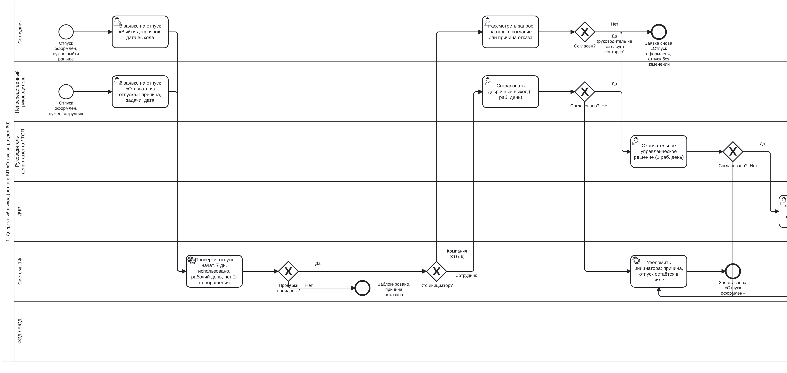
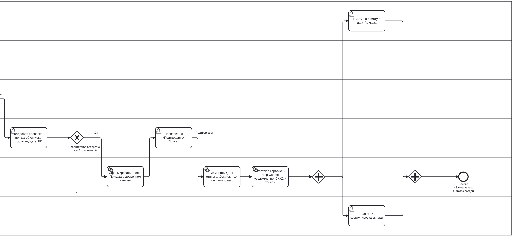
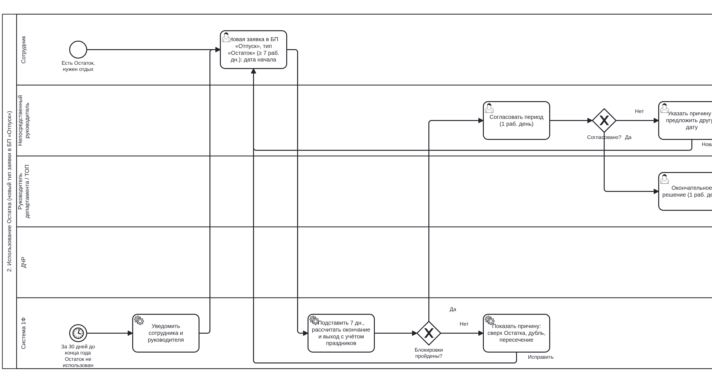
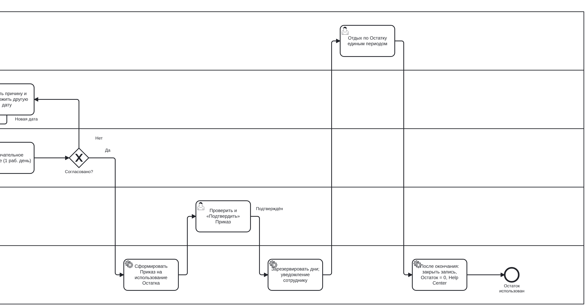

# Техническое задание на доработку «Первой Формы»: досрочный выход из Неделимой части отпуска и использование Остатка

| | |
|---|---|
| Заказчик | Департамент Человеческих Ресурсов (ДЧР) ЗАО «КОИНОТИ НАВ» |
| Исполнитель | Департамент Информационных Технологий (ДИТ) |
| Основание | Приказ об утверждении Инструкции о порядке досрочного выхода из Неделимой части ежегодного трудового отпуска и использования её неиспользованного остатка (далее — Инструкция); Приложение №1 к ней «Требования к автоматизации… (для ДИТ)» |
| Сопутствующие материалы | Схема процесса `dosrochny-vyhod.bpmn` / `.png`; документ «Анализ автоматизации досрочного выхода» |
| Разработал | Файзуллоев Даврон, ведущий специалист Отдела ИТ-проектов ДИТ |
| Версия, дата | 1.1 от 25.11.2026 (досрочный выход встроен в БП «Отпуск») |

## 1. Цель
Перевести в «Первую Форму» (далее — 1Ф) процесс досрочного выхода сотрудника Головного офиса
из Неделимой части ежегодного отпуска (14 календарных дней) и последующего использования
Остатка, без ручного учёта ДЧР. 1Ф становится единственным источником данных
об использованных днях и Остатке (Инструкция, п. 3.6).

**Принцип решения.** Новый БП не создаётся. Досрочный выход и использование Остатка
встраиваются в существующий БП «Заявка на предоставление отпуска и отгулов»
(раздел 1Ф id 60, категория HR):
- досрочный выход — дополнительная ветка статусов внутри той же заявки на отпуск
  (Приложение №1, п. 2: «действия запускают дополнительный маршрут внутри исходной Заявки»);
- использование Остатка — новый тип заявки в том же разделе.

Так вся история отпуска хранится в одной карточке, переиспользуются уже настроенные
маршрут, подписи и автоисполнители по оргструктуре, а правило «одно активное обращение
на один отпуск» выполняется само.

## 2. Границы
**Входит:**
- досрочный выход по просьбе сотрудника и по инициативе Компании (отзыв);
- согласование, кадровая проверка, формирование и подтверждение Приказа;
- автоматический расчёт использованных дней и Остатка;
- заявка на использование Остатка, её согласование и Приказ;
- уведомления, напоминание за 30 дней до конца года;
- отображение Остатка в карточке сотрудника и в Help Center;
- служебная корректировка ДЧР с журналом.

**Не входит:**
- Делимая часть отпуска (Инструкция, п. 1.10) — работает по действующему БП по отпускам;
- расчёт сумм отпускных и зарплаты — делают ФЭД и БЮД (п. 3.8);
- интеграция со СКУД и табелем, если её сейчас нет, — отдельная задача (см. п. 12).

## 3. Термины
| Термин | Значение |
|---|---|
| Неделимая часть | Часть ежегодного отпуска, 14 календарных дней, предоставляется одним периодом |
| Делимая часть | Остальная часть ежегодного отпуска, регулируется БП по отпускам |
| Досрочный выход | Выход на работу до окончания Неделимой части |
| Отзыв | Досрочный выход по инициативе Компании, только с согласия сотрудника |
| Остаток | Неиспользованные дни Неделимой части после досрочного выхода |
| Исходная заявка | Заявка на отпуск (Неделимая часть), из которой запускается досрочный выход |
| Обращение | Ветка досрочного выхода внутри исходной заявки (по просьбе сотрудника или отзыв) |
| Приказ | Приказ о досрочном выходе или Приказ на использование Остатка |
| Рабочий день | День, не являющийся выходным или нерабочим праздничным по производственному календарю |

## 4. Роли и права
| Роль | Кто в 1Ф | Права |
|---|---|---|
| Сотрудник | Автор исходной заявки | «Выйти досрочно»; согласие/отказ при отзыве; заявка на Остаток; просмотр своих балансов |
| Непосредственный руководитель | Руководитель из оргструктуры 1Ф | «Отозвать из отпуска»; согласование |
| Руководитель департамента | Руководитель департамента сотрудника | Окончательное согласование |
| Вышестоящий ТОП | Для руководителя департамента (см. вопрос 3) | Окончательное согласование |
| ДЧР | Группа пользователей «ДЧР» | Кадровая проверка, «Сформировать Приказ», «Подтвердить», «Вернуть», служебная корректировка |
| ФЭД, БЮД | Группы пользователей | Только чтение подтверждённых Приказов |
| Администратор 1Ф | — | Настройка, справочники |

Маршрут согласования строится по оргструктуре 1Ф (Инструкция, п. 1.9, 2.5.1):
- сотрудник отдела или департамента → непосредственный руководитель → руководитель департамента;
- руководитель отдела → руководитель департамента;
- руководитель департамента → вышестоящий руководитель из ТОП-менеджмента.

Если непосредственный руководитель и есть руководитель департамента, этап выполняется
один раз (п. 2.5.2). При отзыве инициатор свой запрос повторно не согласует (п. 2.5.3).

## 5. Объекты и поля
### 5.1 Заявка на отпуск (раздел id 60) — общие поля
| Код | Поле | Тип | Заполнение | Примечание |
|---|---|---|---|---|
| ZO-01 | Неделимая часть, дней | Число | Константа 14 | Только чтение |
| ZO-02 | Фактическая дата начала отпуска | Дата | Из заявки | Используется в расчётах |
| ZO-03 | Фактическая дата окончания отпуска | Дата | Из заявки; меняется Приказом о досрочном выходе | Только чтение для всех, кроме автоматики |
| ZO-04 | Признак «Досрочный выход оформлен» | Да / Нет | Авто | Да после подтверждения Приказа |
| ZO-05 | Кнопка «Выйти досрочно» | Действие | — | Видна автору; условия — п. 8.1 |
| ZO-06 | Кнопка «Отозвать из отпуска» | Действие | — | Видна непосредственному руководителю; условия — п. 8.1 |

В справочник «Тип заявки» (раздел id 59) добавить значение «Остаток Неделимой части».

### 5.2 Блок «Досрочный выход» в карточке заявки на отпуск
Блок полей добавляется в ту же карточку раздела 60. Блок виден, только когда заявка
находится в статусах ветки «ДВ:» (п. 6.1) или досрочный выход уже оформлен; в остальных
случаях скрыт. При повторном обращении после отказа поля блока заполняются заново,
прошлые попытки остаются в истории карточки.
| Код | Поле | Тип | Обязательность | Заполнение |
|---|---|---|---|---|
| DV-01 | Номер попытки | Число | — | Авто: 1, 2… |
| DV-03 | Сотрудник | Пользователь | — | Автор заявки |
| DV-04 | Инициатор | Список: Сотрудник / Компания | — | Авто по нажатой кнопке |
| DV-05 | Дата начала отпуска | Дата | — | Авто из ZO-02 |
| DV-06 | Плановая дата окончания отпуска | Дата | — | Авто из ZO-03 |
| DV-07 | Дата выхода на работу | Дата | Да | Ввод инициатора |
| DV-08 | Использовано дней (предварительно) | Число | — | Расчёт по п. 7.1, только чтение |
| DV-09 | Ожидаемый Остаток | Число | — | Расчёт по п. 7.2, только чтение |
| DV-10 | Причина отзыва | Текст | Да, если инициатор — Компания | Ввод руководителя |
| DV-11 | Необходимые задачи | Текст | Да, если инициатор — Компания | Ввод руководителя |
| DV-12 | Согласие сотрудника | Да / Нет | Да, если инициатор — Компания | Ввод сотрудника |
| DV-13 | Причина отказа сотрудника | Текст | Да, если DV-12 = Нет | Ввод сотрудника |
| DV-14 | Причина отказа / возврата | Текст | Да при отказе или возврате | Ввод согласующего / ДЧР |
| DV-15 | Альтернативная дата | Дата | Нет | Ввод согласующего |
| DV-16 | Приказ о досрочном выходе | Файл | — | Авто по шаблону (п. 11) |
| DV-17 | Дата подтверждения Приказа | Дата/время | — | Авто |
| DV-18 | Подтвердил | Пользователь | — | Авто |
| DV-19 | Использовано дней (итог) | Число | — | Авто при подтверждении |
| DV-20 | Остаток (итог) | Число | — | Авто при подтверждении |

### 5.3 Баланс сотрудника (карточка сотрудника)
| Код | Поле | Тип | Заполнение |
|---|---|---|---|
| BL-01 | Неделимая часть предоставлено, дней | Число | 14 на год |
| BL-02 | Неделимая часть использовано, дней | Число | Авто |
| BL-03 | Остаток Неделимой части, доступно, дней | Число | Авто; меняется только Приказом или служебной корректировкой |
| BL-04 | Остаток Неделимой части, зарезервировано, дней | Число | Авто |
| BL-05 | Год образования Остатка | Число | Авто |
| BL-06 | Делимая часть, доступно, дней | Число | Существующий учёт; с BL-03 не суммируется |

Балансы Неделимой части, Остатка и Делимой части хранятся раздельно и не объединяются
(Приложение №1, п. 1). Скрытые поля раздела 60 «Остаток по неделимой части» и
«Остаток по делимой части» переиспользовать после ответа на вопрос 7 (п. 16).

### 5.4 Заявка на использование Остатка (раздел id 60, тип «Остаток Неделимой части»)
| Код | Поле | Тип | Обязательность | Заполнение |
|---|---|---|---|---|
| ZR-01 | Исходная заявка на отпуск (с оформленным досрочным выходом) | Ссылка на задачу раздела 60 | — | Авто |
| ZR-02 | Доступный Остаток | Число | — | Авто из BL-03, только чтение |
| ZR-03 | Дата начала | Дата | Да | Ввод сотрудника |
| ZR-04 | Количество дней | Число | — | = BL-03 (7), только чтение |
| ZR-05 | Дата окончания | Дата | — | Расчёт по п. 7.3 |
| ZR-06 | Дата выхода на работу | Дата | — | Расчёт по п. 7.3 |
| ZR-07 | Причина отказа | Текст | Да при отказе | Ввод согласующего |
| ZR-08 | Предложенная другая дата | Дата | Да при отказе (п. 4.11) | Ввод согласующего |
| ZR-09 | Приказ на использование Остатка | Файл | — | Авто по шаблону |

## 6. Статусные модели
### 6.1 Статусы раздела 60 для заявки на отпуск
Существующие статусы сохраняются. Добавляются статус «Отпуск оформлен» и ветка «ДВ:».

| Код | Статус | Новый? | Ответственный | Срок |
|---|---|---|---|---|
| — | Новая, Обработка заявки (и ветка больничных) | Есть | Как сейчас | Как сейчас |
| S0 | Отпуск оформлен | Новый, не конечный | — | До даты окончания отпуска |
| S1 | ДВ: Согласие сотрудника | Новый | Сотрудник | 1 рабочий день |
| S2 | ДВ: Согласование руководителя | Новый | Непосредственный руководитель | 1 рабочий день |
| S3 | ДВ: Согласование руководителя департамента | Новый | Рук. департамента / ТОП | 1 рабочий день |
| S4 | ДВ: Проверка ДЧР | Новый | ДЧР | 1 рабочий день |
| S5 | ДВ: Приказ сформирован | Новый | ДЧР | 1 рабочий день |
| S6 | Завершена | Есть (включить) | — | Конечный |

**Почему нужен «Отпуск оформлен».** Сейчас согласованная заявка уходит в «Завершена».
Это конечный статус, а в завершённых задачах 1Ф ограничивает действия, поэтому кнопки
досрочного выхода в ней не сработают. Согласованная заявка на Неделимую часть должна
стоять в «Отпуск оформлен» до конца отпуска. В «Завершена» она переходит автоматически
на следующий день после фактической даты окончания отпуска (ZO-03) или сразу после
подтверждения Приказа о досрочном выходе (A-06). Для остальных типов заявок маршрут
не меняется.

### 6.2 Переходы
| Из | В | Кнопка | Кто | Условие |
|---|---|---|---|---|
| Обработка заявки | S0 | Завершить (существующая кнопка, новый адрес) | Как сейчас | Тип заявки — «Основной (неделимый)» |
| S0 | S6 | — (автоматически) | 1Ф | Наступил день после ZO-03 |
| S0 | S1 | Отозвать из отпуска | Непосредственный руководитель | Условия п. 8.1; проверки п. 8.2 пройдены; DV-10, DV-11, DV-07 заполнены |
| S0 | S2 | Выйти досрочно | Сотрудник | Условия п. 8.1; проверки пройдены; DV-07 заполнена; у сотрудника есть непосредственный руководитель ниже руководителя департамента |
| S0 | S3 | Выйти досрочно | Сотрудник | То же; непосредственный руководитель = руководитель департамента |
| S1 | S3 | Согласен | Сотрудник | DV-12 = Да. Шаг S2 пропускается (инициатор не согласует повторно) |
| S1 | S0 | Отказываюсь | Сотрудник | DV-13 заполнено |
| S2 | S3 | Согласовать | Руководитель | — |
| S2 | S0 | Отказать | Руководитель | DV-14 заполнено |
| S3 | S4 | Согласовать | Рук. департамента / ТОП | — |
| S3 | S0 | Отказать | Рук. департамента / ТОП | DV-14 заполнено |
| S4 | S5 | Сформировать Приказ | ДЧР | Кадровая проверка выполнена |
| S4 | S0 | Вернуть | ДЧР | DV-14 заполнено |
| S5 | S6 | Подтвердить | ДЧР | Сегодня < DV-07 (п. 8.3) |
| S5 | S4 | Вернуть на проверку | ДЧР | — |

Отказ на любом шаге возвращает заявку в «Отпуск оформлен»: исходный отпуск не меняется
(Инструкция, п. 2.5.6). Если отзыв инициировал руководитель департамента, после S1
заявка идёт сразу в S4. Подписи на шагах S2, S3 — уже настроенные в разделе 60.

### 6.3 Заявка на использование Остатка
| Код | Статус | Ответственный | Срок |
|---|---|---|---|
| R0 | Черновик | Сотрудник | — |
| R1 | Согласование руководителя | Непосредственный руководитель | 1 рабочий день |
| R2 | Согласование руководителя департамента | Рук. департамента / ТОП | 1 рабочий день |
| R3 | Проверка ДЧР / Приказ сформирован | ДЧР | 1 рабочий день |
| R4 | Приказ подтверждён (дни зарезервированы) | — | До начала периода |
| R5 | Использован | — | Конечный |
| R6 | Отклонено / Отменено | — | Конечный; резерв возвращается |

Маршрут R1 → R2 строится по тем же правилам, что в п. 6.2. При отказе на R1/R2
заявка возвращается в R0 с причиной и предложенной датой (ZR-07, ZR-08).

## 7. Правила расчёта
### 7.1 Использованные дни
Использовано = число календарных дней с даты начала отпуска (DV-05) по день,
предшествующий дате выхода (DV-07), включительно, минус нерабочие праздничные дни
в этом интервале (они не засчитываются в ежегодный отпуск; Инструкция, п. 3.3).
Источник праздников — справочник производственного календаря (п. 12.1).

### 7.2 Остаток
Остаток = 14 − Использовано (п. 3.4). Для стандартного досрочного выхода
Использовано = 7, Остаток = 7. Пользователь расчёт не меняет.

### 7.3 Даты по заявке на Остаток
Дата окончания = дата начала + Остаток календарных дней − 1, продлённая на число
нерабочих праздничных дней внутри периода. Дата выхода = следующий рабочий день
после даты окончания.

### 7.4 Изменение балансов
| Событие | BL-02 | BL-03 | BL-04 |
|---|---|---|---|
| Подтверждён Приказ о досрочном выходе | = DV-19 | = DV-20 | 0 |
| Подтверждён Приказ на Остаток | — | − ZR-04 | + ZR-04 |
| Приказ на Остаток отменён до начала периода | — | + ZR-04 | − ZR-04 |
| Окончание периода использования Остатка | + ZR-04 | 0 | 0 |
| Служебная корректировка ДЧР | по вводу | по вводу | по вводу |

## 8. Проверки и блокировки
### 8.1 Видимость кнопок в исходной заявке
Кнопки «Выйти досрочно» и «Отозвать из отпуска» видны, только если одновременно:
- тип заявки — «Основной (неделимый)»;
- заявка в статусе «Отпуск оформлен» (S0) — значит, ветка «ДВ:» сейчас не идёт;
- сегодня ≥ фактической даты начала отпуска и ≤ даты окончания;
- досрочный выход по этой заявке ещё не оформлен (ZO-04 = Нет).

### 8.2 Проверки при отправке обращения
| Код | Условие | Текст пользователю | Действие |
|---|---|---|---|
| E-01 | Неделимая часть не оформлена или не началась | «Досрочный выход возможен только после начала Неделимой части отпуска» | Блок |
| E-02 | Использовано ≠ 7 дней на дату выхода | «Досрочный выход возможен после использования 7 календарных дней отпуска. Ближайшая допустимая дата выхода: {дата}» | Блок |
| E-03 | Дата выхода — выходной или праздник | «Дата выхода должна быть рабочим днём» | Блок |
| E-04 | По этому отпуску досрочный выход уже оформлен или ветка «ДВ:» уже идёт | «По этому отпуску досрочный выход уже оформлен или находится на согласовании» | Блок (обычно не нужен: кнопки скрыты по п. 8.1) |
| E-05 | До даты выхода меньше 2 рабочих дней | «Срок меньше 2 рабочих дней. Обращение будет передано ДЧР для проверки возможности оформления» | Предупреждение, отправка разрешена |
| E-06 | Нет данных для расчёта (нет календаря, нет дат) | «Недостаточно кадровых сведений. Обращение передано в ДЧР» | Переход сразу в S4 без автоматического завершения |
| E-07 | Дата выхода не позже плановой даты окончания отпуска | «Дата выхода должна быть раньше окончания отпуска» | Блок |

### 8.3 Запрет оформления задним числом
Кнопка «Подтвердить» (S5 → S6) недоступна, если сегодня ≥ DV-07. Текст:
«Приказ должен быть подтверждён до даты выхода. Для исправления используйте служебную корректировку ДЧР».

### 8.4 Проверки заявки на Остаток
| Код | Условие | Текст | Действие |
|---|---|---|---|
| R-01 | Остаток = 0 | «У вас нет Остатка Неделимой части» | Создание запрещено |
| R-02 | Дата начала раньше чем через 7 рабочих дней | «Заявку на Остаток нужно подать не позднее чем за 7 рабочих дней до начала» | Блок |
| R-03 | Есть другая активная заявка на этот Остаток | «Остаток уже запланирован заявкой №{номер}» | Блок |
| R-04 | Период пересекается с другим оформленным отсутствием | «Период пересекается с {тип отсутствия} {даты}» | Блок |
| R-05 | Попытка изменить количество дней | — | Поле только для чтения |
| R-06 | Дата начала в следующем году | «Остаток нужно использовать до конца года, в котором он образовался» | Блок |

## 9. Автоматические действия
| № | Событие | Действие 1Ф |
|---|---|---|
| A-01 | Нажата кнопка в заявке (S0) | Показать блок «Досрочный выход», заполнить DV-01, DV-03…DV-06, DV-04; перевести заявку в ветку «ДВ:» |
| A-02 | Изменена DV-07 | Пересчитать DV-08, DV-09 |
| A-03 | Отправка обращения | Выполнить проверки п. 8.2, построить маршрут по п. 4 |
| A-04 | Отказ на любом шаге ветки (возврат в S0) | Уведомить инициатора и сотрудника с причиной; исходная заявка без изменений |
| A-05 | Переход в S5 | Сформировать Приказ по шаблону (п. 11), приложить в DV-16 |
| A-06 | «Подтвердить» (S5 → S6) | Записать DV-17…DV-20, ZO-04 = Да; изменить ZO-03 на (DV-07 − 1 день); изменить балансы по п. 7.4; записать историю; уведомление п. 10.1; передать данные в СКУД и табель (п. 12.2) |
| A-07 | Подтверждён Приказ на Остаток | Резерв дней; уведомление п. 10.2 |
| A-08 | Отмена заявки на Остаток в R4 до начала | Вернуть резерв |
| A-09 | Наступил день после окончания периода Остатка | Перевести заявку в R5, BL-03 = 0, обновить Help Center |
| A-10 | Ежегодно 1 декабря | Если BL-03 > 0 и нет активной заявки на Остаток — задача-уведомление сотруднику и непосредственному руководителю (п. 10.3) |
| A-11 | Шаг не выполнен за 1 рабочий день | Напоминание ответственному, копия — руководителю ответственного |

## 10. Уведомления
### 10.1 После подтверждения Приказа о досрочном выходе (сотруднику)
«Досрочный выход оформлен с {Дата_выхода}. Использовано дней Неделимой Части: {Использовано_дней}.
Остаток Неделимой Части: {Остаток_дней} календарных дней.»
Копия — непосредственному руководителю.

### 10.2 После подтверждения Приказа на использование Остатка (сотруднику)
«Использование Остатка Неделимой Части согласовано на период {Период}.
Доступный Остаток: {Остаток_дней} календарных дней.»

### 10.3 За 30 дней до конца года (сотруднику и руководителю)
«У вас есть неиспользованный Остаток Неделимой Части: {Остаток_дней} календарных дней.
Его нужно согласовать и использовать до конца {Год} года.»

### 10.4 Прочие
- Новое задание на согласование — ответственному шага.
- Отказ, возврат — инициатору с причиной.
- Запрос на отзыв — сотруднику, с причиной и предлагаемой датой выхода.

## 11. Печатные формы
| Форма | Когда формируется | Поля |
|---|---|---|
| Приказ о досрочном выходе из Неделимой части | Переход в S5 | ФИО, должность, подразделение; реквизиты исходного Приказа об отпуске; основание (просьба сотрудника / отзыв с согласием); дата выхода; использовано дней; Остаток |
| Приказ на использование Остатка | Переход в R3 | ФИО, должность, подразделение; период; количество дней; дата выхода |

Шаблоны (.docx) предоставляет ДЧР (вопрос 4). Формирование — штатным механизмом шаблонов 1Ф.

## 12. Справочники и интеграции
### 12.1 Производственный календарь
Справочник выходных и нерабочих праздничных дней Республики Таджикистан на текущий
и следующий год. Ведёт ДЧР. Без него расчёты п. 7 и проверки E-03, R-02 не работают.

### 12.2 СКУД и табель
При переходе в S6 и при окончании периода Остатка передать: сотрудник, фактический период
отпуска, дата выхода. Если интеграции нет — ДЧР передаёт данные по действующему маршруту
(Приложение №1, п. 6), второй реестр не создаётся.

## 13. Help Center
В информационном блоке об отпусках (портал Help Center) добавить поле «Остаток Неделимой Части»:
значение BL-03 в календарных днях. Поле видно только при BL-03 > 0
(Приложение №1, п. 8), обновляется автоматически.

## 14. Служебная корректировка и история
- Действие «Служебная корректировка» в карточке баланса доступно только группе ДЧР.
- Обязательные поля: причина, новое значение. Автоматически: дата, время, исполнитель,
  прежнее значение.
- Все изменения дат отпуска и балансов пишутся в историю 1Ф: дата, время, пользователь,
  прежнее и новое значение, основание (номер Приказа или корректировки) (Инструкция, п. 3.9).

## 15. Нефункциональные требования
- Срок рассмотрения на каждом шаге — 1 рабочий день (п. 2.5.7), с напоминанием (A-11).
- Все тексты на русском языке, понятные пользователю, без технических кодов.
- Работа с телефона в мобильном приложении 1Ф: кнопки, согласие, согласование.
- Права: сотрудник видит только свои обращения и балансы; руководитель — своих подчинённых;
  ДЧР — все.

## 16. Открытые вопросы (ответ до начала разработки)
1. Есть ли в 1Ф производственный календарь Таджикистана? Если нет — кто и когда его заводит.
2. Есть ли интеграция 1Ф со СКУД и табелем?
3. Кто «вышестоящий руководитель из ТОП» для руководителей департаментов — из оргструктуры
   1Ф или отдельным справочником?
4. Шаблоны двух Приказов в .docx — предоставляет ДЧР.
8. В каком статусе сейчас заканчиваются согласованные заявки на отпуск? Статусы
   «Завершена» и «Отклонена» в разделе 60 выключены. От ответа зависит, как вводить
   статус «Отпуск оформлен» (п. 6.1).
9. Можно ли в 1Ф делать переходы из статуса заявки, когда отпуск уже идёт, без ограничений
   «завершённой задачи»? Подтвердить с администратором 1Ф на тестовом контуре.
5. Если между началом отпуска и выходом попал праздник: «использовано 7 дней» — отпускных
   (без праздника) или календарных? По п. 3.3 Инструкции — отпускных.
6. Какой блок Help Center показывает отпуска сейчас — доработать его или сделать новый?
7. Заполняются ли сейчас скрытые поля «Остаток по неделимой/делимой части» в разделе 60?
   Переиспользовать их или завести новые.

## 17. Этапы
| Этап | Содержание | Результат |
|---|---|---|
| 1 | Справочники: производственный календарь, тип заявки «Остаток», шаблоны Приказов | Основа для расчётов |
| 2 | Раздел 60: статус «Отпуск оформлен», блок «Досрочный выход», ветка статусов «ДВ:», кнопки, проверки, расчёты, Приказ, уведомления | Досрочный выход в 1Ф внутри заявки на отпуск |
| 3 | Заявка на Остаток: расчёт дат, блокировки, резерв, закрытие | Использование Остатка в 1Ф |
| 4 | Балансы в карточке, Help Center, напоминание 1 декабря, служебная корректировка | Полный объём Приложения №1 |
| 5 | Интеграция СКУД и табеля (если отсутствует) | Без ручной передачи |

До окончания внедрения действует п. 3 Приказа: ДЧР оформляет досрочный выход вручную
и затем переносит данные в 1Ф.

## 18. Приёмка
Приёмка — на тестовом контуре, по контрольным примерам. Этап принят, если все примеры
этапа прошли и замечаний, блокирующих работу, нет.

| № | Действие | Ожидаемый результат |
|---|---|---|
| 1 | Сотрудник до начала отпуска открывает исходную заявку | Кнопки «Выйти досрочно» нет |
| 2 | На 3-й день отпуска нажимает «Выйти досрочно», дата выхода — 4-й день | Блок E-02 с ближайшей допустимой датой |
| 3 | Дата выхода — суббота | Блок E-03 |
| 4 | Корректная дата → согласования → ДЧР «Сформировать Приказ» → «Подтвердить» | Приказ в DV-16; ZO-03 изменена; BL-03 = 7; уведомление 10.1 пришло; запись в истории |
| 5 | Руководитель «Отозвать из отпуска», сотрудник «Отказываюсь» | Заявка вернулась в «Отпуск оформлен», отпуск не изменён, руководитель получил причину |
| 6 | Отзыв, сотрудник «Согласен» | Шаг S2 пропущен, заявка у руководителя департамента |
| 7 | Сотрудник, у которого руководитель = руководитель департамента | Один шаг согласования |
| 8 | Заявка в ветке «ДВ:» — сотрудник ищет кнопку ещё раз | Кнопок нет |
| 9 | ДЧР пытается «Подтвердить» в день выхода или позже | Кнопка недоступна, текст п. 8.3 |
| 10 | Заявка на Остаток с началом через 3 рабочих дня | Блок R-02 |
| 11 | Заявка на Остаток, пытаемся поставить 10 дней | Поле количества дней недоступно, всегда 7 |
| 12 | Заявка на Остаток пересекается с другим отпуском | Блок R-04 |
| 13 | Подтверждён Приказ на Остаток, затем отмена до начала | Резерв вернулся в BL-03 |
| 14 | Период Остатка закончился | Заявка в R5, BL-03 = 0, поле в Help Center скрыто |
| 15 | 1 декабря, Остаток не запланирован | Уведомление 10.3 сотруднику и руководителю |
| 16 | Сотрудник не из ДЧР пытается изменить Остаток | Действие недоступно |
| 17 | ДЧР делает служебную корректировку без причины | Сохранение запрещено |
| 18 | Вся история (заявка, досрочный выход, Приказ) | Видна в одной карточке заявки на отпуск |
| 19 | Отпуск без досрочного выхода закончился | Заявка сама перешла из «Отпуск оформлен» в «Завершена» |

## 19. Приложение. Схема процесса (BPMN)
Полная схема — файлы `dosrochny-vyhod.bpmn` и `dosrochny-vyhod.png`.

